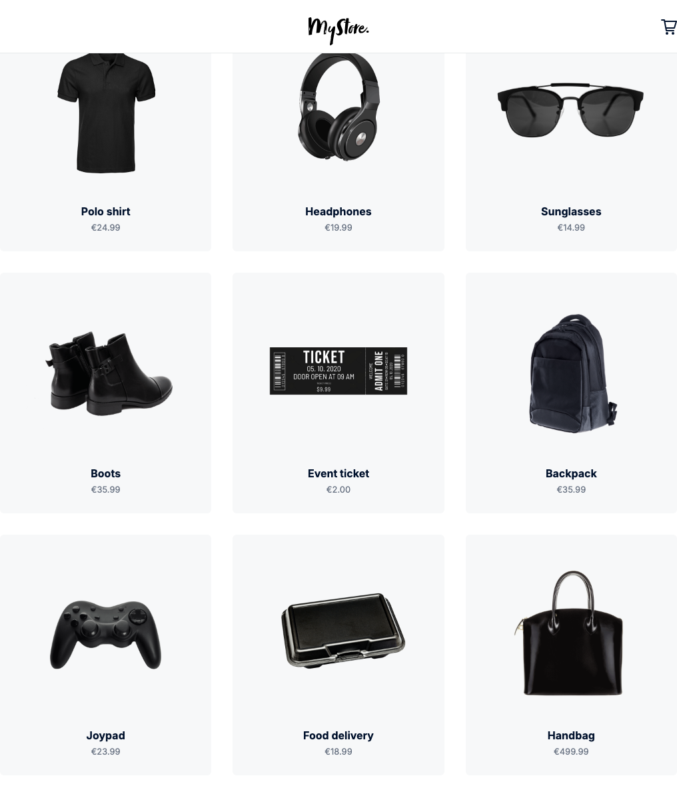
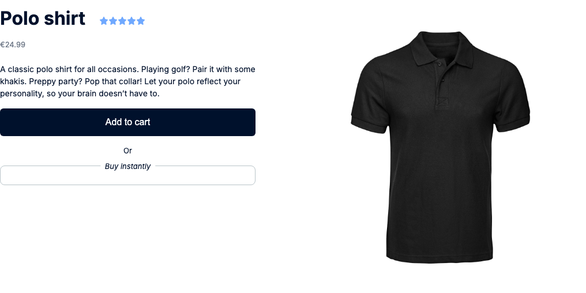

# E-Commerce Test Automation Framework

Playwright and TypeScript tests for the public [MyStore Demo](https://www.mystoredemo.io/#/) e-commerce application. The suite covers product discovery, product details, visual baselines, checkout API contracts, and payment-status validation against sandbox endpoints.

## Architecture

```text
Playwright runner
├── configuration       playwright.config.ts and environment files
├── fixtures            shared navigation and page-object setup
├── page objects        reusable PLP/PDP interactions and assertions
├── UI tests            functional and visual browser journeys
├── API tests           checkout-session and payment-details contracts
└── reporters           console, HTML, and Monocart output
```

The fixture layer opens the application and handles shared browser setup. Page objects contain screen-specific behavior, while tests retain the business assertions. API tests use Playwright's isolated request context and do not require a browser page.

## Folder structure

| Path                              | Purpose                                       |
| --------------------------------- | --------------------------------------------- |
| `ui-tests/fixtures/`              | Shared Playwright fixtures                    |
| `ui-tests/pages/`                 | Page objects for PLP, PDP, cart, and checkout |
| `ui-tests/tests/product-landing/` | Product-list tests                            |
| `ui-tests/tests/product-details/` | Product-detail tests                          |
| `ui-tests/tests/snapshots/`       | Visual regression tests                       |
| `ui-tests/tests/api/`             | Checkout and payment API contract tests       |
| `snapshots/`                      | Reviewed visual baselines                     |
| `.github/workflows/`              | GitHub Actions pipelines                      |
| `docs/`                           | Supporting engineering evidence               |

## Coverage

| Layer             | Current evidence                                                                                 |
| ----------------- | ------------------------------------------------------------------------------------------------ |
| Product listing   | Open a product and validate navigation                                                           |
| Product detail    | Validate product actions and recommendations                                                     |
| Visual regression | PLP and PDP component screenshots                                                                |
| Checkout API      | Create an embedded payment session and validate order amount, currency, ID, and expiry           |
| Payment details   | Validate that an invalid redirect result is rejected with the expected status and error contract |
| Browsers          | Desktop Chromium, Firefox, and WebKit in CI; optional mobile Chrome and Safari projects          |

The original recommendation referred to a ReserveX booking API. This repository is an e-commerce checkout project, so the equivalent API evidence validates checkout-session creation and payment-details status/error handling instead of claiming a booking flow that does not exist.

## Installation

Requirements: Node.js 20 or later.

```bash
npm ci
npx playwright install
```

For Linux CI agents, install the browser system dependencies too:

```bash
npx playwright install --with-deps chromium firefox webkit
```

## Environment configuration

The `ENV` variable selects `.env.develop` or `.env.integration`.

| Variable                 | Meaning                                                         | Default                          |
| ------------------------ | --------------------------------------------------------------- | -------------------------------- |
| `BASE_URL`               | Application URL                                                 | From selected `.env` file        |
| `PLATFORM_BROWSER_NAME`  | One browser project (backwards compatible)                      | `desktop-chromium`               |
| `PLATFORM_BROWSER_NAMES` | Comma-separated browser matrix                                  | Falls back to the singular value |
| `HEADLESS`               | Set to `false` only when a visible browser is needed            | `true`                           |
| `WORKER_COUNT`           | Parallel Playwright workers (`WORKERS_COUNT` remains supported) | `4`                              |
| `TIMEOUT`                | Per-test timeout in milliseconds                                | `30000`                          |

Supported project names are `desktop-chromium`, `desktop-firefox`, `desktop-webkit`, `mobile-android-chrome`, and `mobile-ios-safari`.

Examples:

```bash
# One headed browser for local debugging
ENV=develop HEADLESS=false PLATFORM_BROWSER_NAME=desktop-chromium npm test

# Desktop browser matrix in one execution
ENV=integration PLATFORM_BROWSER_NAMES=desktop-chromium,desktop-firefox,desktop-webkit npm test
```

## Commands

| Command                      | Purpose                                                 |
| ---------------------------- | ------------------------------------------------------- |
| `npm test`                   | Type-check, then run the configured Playwright projects |
| `npm run typecheck`          | Compile-time validation without emitting files          |
| `npm run test:api`           | Checkout and payment-details API tests                  |
| `npm run test:smoke`         | Tests tagged `@Smoke`                                   |
| `npm run test:regression`    | Tests tagged `@FullRegression`                          |
| `npm run test:snapshot`      | Visual tests tagged `@Snapshot`                         |
| `npm run test:cross-browser` | Full suite on desktop Chromium, Firefox, and WebKit     |
| `npm run report:monocart`    | Open the generated Monocart report                      |

## Failure evidence and reports

- A trace is recorded for every test and retained on its first failure, including failures that pass on retry.
- A screenshot is retained on failure.
- Console, Playwright HTML, and Monocart reporters are generated for each run.
- CI uploads `playwright-report/` and `test-results/` for 14 days, even when a test fails.

Open the Playwright HTML report locally with:

```bash
npx playwright show-report
```

Example reviewed visual baselines:

| Product list                                                                                                                               | Product detail                                                                                                                               |
| ------------------------------------------------------------------------------------------------------------------------------------------ | -------------------------------------------------------------------------------------------------------------------------------------------- |
|  |  |

## CI/CD workflow

`.github/workflows/.github-full-regression.yml` runs on pushes to `main`, pull requests, and manual dispatch. It:

1. installs pinned npm dependencies;
2. installs Chromium, Firefox, and WebKit with system dependencies;
3. type-checks the suite;
4. runs the API smoke tests;
5. runs `@FullRegression` UI tests across all three desktop engines;
6. uploads reports, traces, and screenshots;
7. optionally sends the configured Slack notification and fails the job when regression failures are reported.

## AI-assisted engineering evidence

The documented example in [docs/ai-assisted-testing.md](docs/ai-assisted-testing.md) records the AI tool actually used, the generated/refactored areas, the human review checklist, and manual validation. It deliberately makes no claim about tools that were not used.
